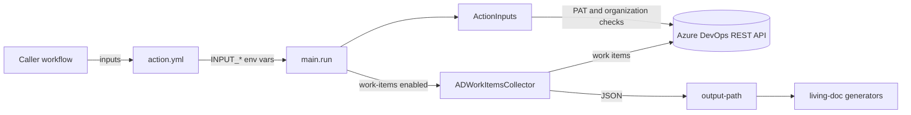

# living-doc-collector-ad

## Purpose

Composite GitHub Action that mines Azure DevOps organizations and projects for living-documentation data and writes
machine-readable JSON for the downstream `living-doc-*` generators. Part of the AbsaOSS living-doc ecosystem; shared
code comes from `living-doc-utilities`.

Not responsible for: rendering documentation (the generators do that). The supported runtime is a GitHub-hosted
runner; running `python3 main.py` locally is a development and debugging aid only.

## Tech stack

- Python, floor 3.10 (`requires-python`, and the Black, ruff and mypy targets in `pyproject.toml`); CI runs 3.10–3.14,
  and the published action image runs 3.14.
- `requests` for the Azure DevOps REST API (`api-version=7.0`).
- `living-doc-utilities`, pinned in `requirements.txt`: `get_action_input`, `set_action_output`, `BaseActionInputs`,
  `setup_logging`, `OUTPUT_PATH`.
- Quality: Black, ruff, Pylint, mypy, pytest with pytest-cov, pytest-mock and `responses`. Config in `pyproject.toml`
  and `.pylintrc`; the `Makefile` targets wrap them, and CI calls the same targets.

## Structure

| Path | Responsibility |
|---|---|
| `action.yml` | Action contract (inputs, `output-path` output); composite steps install `requirements.txt`, map inputs to `INPUT_*` env vars, run `main.py` |
| `main.py` | Entry point `run()`: logging, user-config validation, mode dispatch, `output-path` output, exit code |
| `action_inputs.py` | `ActionInputs(BaseActionInputs)`: reads every `INPUT_*`, validates the PAT and each organization against the ADO REST API, parses `work-items-organizations` |
| `work_items/` | `work-items` mode: `collector.py` (`ADWorkItemsCollector`), `model/config_organization.py` (`ConfigOrganization`) |
| `utils/` | `constants.py` (`Mode` enum, input key names), `exceptions.py` (`FetchOrganizationsException`), `utils.py` (`make_absolute_path`) |
| `tests/` | Unit tests and mock targets: [tests/CONTEXT.md](tests/CONTEXT.md) |
| `.github/` | CI workflows and pull request checks: [.github/CONTEXT.md](.github/CONTEXT.md) |

## How it fits together

`main.run()` steps, in this order: `setup_logging()` → `ActionInputs().validate_user_configuration()`, exit `1` on
failure → when `work-items` is enabled, `ADWorkItemsCollector(output_path).collect()` →
`set_action_output("output-path", output_path)` → exit `1` if any enabled mode failed.

## Contracts

Inputs, parsed only in `ActionInputs`. Key names live in `utils/constants.py`; keep them, `action.yml` and
`requirements.txt` in step when inputs or dependencies change.

| Input | Env var | Required | Notes |
|---|---|---|---|
| `ADO-TOKEN` | `INPUT_ADO_TOKEN` | yes | Azure DevOps PAT, a secret |
| `work-items` | `INPUT_WORK_ITEMS` | no | mode switch, default `false` |
| `verbose-logging` | `INPUT_VERBOSE_LOGGING` | no | default `false` |
| `work-items-organizations` | `INPUT_WORK_ITEMS_ORGANIZATIONS` | no | JSON array, default `[]`; needed when `work-items` is `true`; `action.yml` sets it only then, compacted with `jq -c` |

An organization entry is `{"organization-name": "<org>", "projects-name-filter": ["<project>"]}`;
`ConfigOrganization.load_from_json` rejects one without `organization-name`.

Contract-sensitive; change only on purpose, with the tests updated in the same change:

- Action output key `output-path`: `set_action_output` in `main.run()` and `outputs.output-path` in `action.yml`.
- Exit codes: `0` on success, `1` on any failure. There is no `2`–`5` taxonomy.
- The `"Liv-Doc collector for Azure DevOps - ..."` log lines in `run()`: `tests/unit/test_main.py` asserts the exact
  text.
- A mode collector's `collect()` returns `bool`; `run()` maps `False` to exit `1`.

## Running it

Commands are in `AGENTS.md` § This project. A local run needs the `INPUT_*` variables set (`DEVELOPER.md` § Run Scripts
Locally) and calls the real Azure DevOps API with the PAT.

## Conventions

- Read inputs only through `ActionInputs`: never call `get_action_input` or `os.getenv("INPUT_...")` elsewhere. Keep
  parsing, defaults and validation there (`_validate()`, `validate_user_configuration()`); collectors and models never
  read the environment.
- Only `main.run()` turns a failure into an exit code. Leaf modules raise the typed exceptions in
  `utils/exceptions.py`; unparseable `work-items-organizations` JSON raises `FetchOrganizationsException`, which
  `_validate()` counts as a configuration error.
- Keep the integration boundaries explicit and mockable: the ADO REST API (`requests`) and the filesystem. Name
  internal helpers `_name`.
- Python 3.10 floor: no 3.11+-only stdlib import or syntax without a `sys.version_info` fallback (`X | Y` unions and
  `match` are 3.10 and fine). A new dependency must support 3.10. When the floor moves, change `pyproject.toml`,
  `.pylintrc` and the CI matrix together.
- Type hints on new public functions and classes. Imports at module top, never inside functions.
- Logging: `logging.getLogger(__name__)`, set up once by `setup_logging()` in `run()`. Lazy `%` formatting, no
  f-strings in log calls, never `print`.
- Docstrings: a short module docstring; a one-line function summary, with `@param` / `@return` / `@raise` lines where
  they add information.
- Don't change existing log texts or error messages without a stated reason.
- No inline lint disables, `# type: ignore` or lowered gate thresholds unless this file records the exception. None
  is recorded.

## Docs lifecycle

A prospective spec (a `SPEC.md`, a mode design doc, a "planned" section) describes what doesn't exist yet. A change
that implements a spec section moves it, in the same change, into the live docs and deletes it from the spec: one
home, no "implemented" markers, no copies.

- `README.md`: user-facing usage and examples.
- A mode `README.md` once the mode exists, such as `work_items/README.md` (later `boards/`, `pipelines/`,
  `test_plans/`, `release_notes/`): mode-specific behavior.
- `DEVELOPER.md`: local development workflow. `CONTRIBUTING.md`: contributor rules.
- Split a partly shipped section. Repoint links to moved content in the same change, so `link-check` stays green.
  Delete a spec, or reduce it to a pointer, once nothing prospective is left.

## Key decisions

- The collect path is AI-free: deterministic Python only, no LLM call between reading inputs and writing JSON
  (`CONTRIBUTING.md` § AI-free Principle).
- The `Makefile` is the single source of the quality gates, and CI calls the same targets, so local runs and CI never
  drift (`Makefile` header).

## Invariants and gotchas

- The ADO PAT is a secret: never log or echo it, and never put it, or the `Authorization` header `_validate()` builds,
  in an error message, exception, test or fixture.
- High-risk areas, review with extra care: `INPUT_*` and `work-items-organizations` parsing in `action_inputs.py`;
  `_call_profile_api` / `_call_org_api` status-code handling (`401`, `404`, other non-`200`), timeouts and rate
  limits; filesystem writes under `output-path`; mode dispatch and exit-code mapping in `main.run()`.
- For changes to security, CI, the input contract or exit codes, also check behavior on missing or malformed inputs,
  safe defaults and backward compatibility.

## Read more

- `README.md`: how to use the action, its inputs and outputs.
- `DEVELOPER.md`: local setup, local run, each quality tool, releasing.
- `CONTRIBUTING.md`: branch naming, PR title and description, target branches, AI-free principle.
